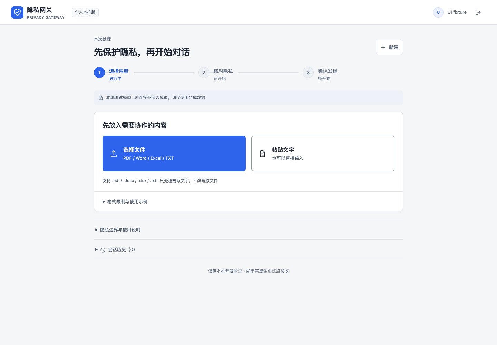
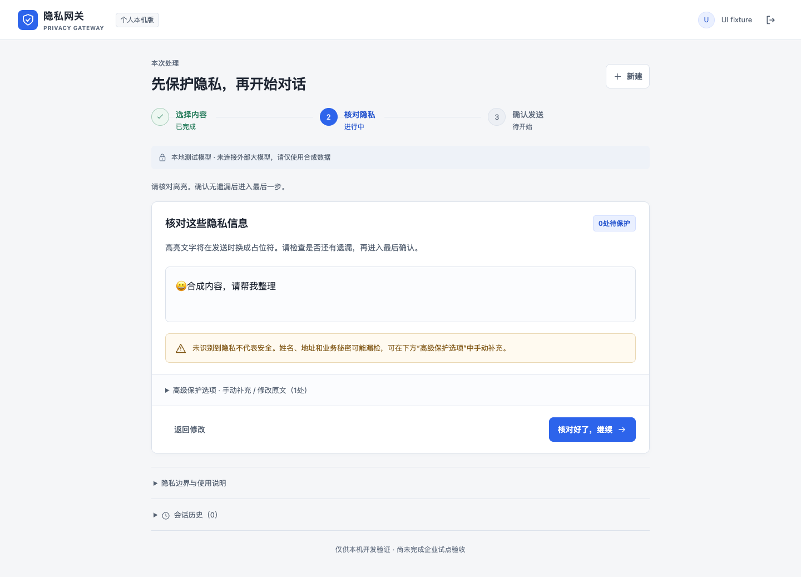

# Local AI Privacy Workbench

[](https://github.com/changhaoting1998-star/local-ai-privacy-workbench/actions/workflows/ci.yml)
[](LICENSE)
[](https://www.python.org/)

A local-first privacy review workflow for text, PDF, DOCX, and XLSX content before it reaches an AI model.

> Status: tested local prototype. The included model is a deterministic local mock. This repository does **not** claim complete DLP coverage or production readiness.



## Why this project

PII detection alone is not enough. A safe workflow also needs human review, an exact outbound preview, explicit send approval, short-lived reversible mappings, and a clear record of what was actually sent.

The workflow is:

1. Paste text or extract reviewable content from PDF, Word, or Excel.
2. Detect common Chinese PII patterns and add manual spans when rules miss context.
3. Review the masked text and the complete outbound conversation.
4. Confirm the exact payload before the local mock model receives it.
5. Restore only tokens bound to that sent message, with explicit local authorization.

## Highlights

- Local FastAPI + React application bound to `127.0.0.1:8910`
- PDF, DOCX, and XLSX extraction with conservative resource limits
- Apple Vision OCR option for scanned PDFs on macOS
- Presidio-based rules for phone, email, Chinese ID, bank account, labeled name, and selected address patterns
- Mandatory blocking for password, API key, private key, bearer token, and credential-like input
- AES-256-GCM encrypted reversible mappings stored separately from SQLite
- Preview expiry, manifest binding, idempotent send, object ownership, CSRF, Origin, and Host checks
- Optional Feishu/Lark SSO with PKCE, tenant pinning, one-time state, and no provider-token persistence
- Synthetic backend, browser, failure, and tamper tests



## Quick start

Requirements: Python 3.12, Node.js 22+, pnpm 11, and macOS for Apple Vision OCR.

```bash
git clone https://github.com/changhaoting1998-star/local-ai-privacy-workbench.git
cd local-ai-privacy-workbench

python3.12 -m venv .venv
.venv/bin/python -m pip install -r requirements.lock.txt

cd frontend
corepack enable
pnpm install --frozen-lockfile
pnpm build
cd ..

.venv/bin/python scripts/run.py
```

Open <http://127.0.0.1:8910/> and create the first local account. There is no default password.

For scanned-PDF OCR on macOS:

```bash
sh scripts/build_file_ocr.sh
```

## Tests

```bash
.venv/bin/python -m pip check
.venv/bin/python -m pytest backend/tests -q

cd frontend
pnpm build
pnpm exec playwright install chromium
pnpm test:ui
```

The read-only runtime probe checks an already-running service:

```bash
.venv/bin/python quality/runtime_stability_probe.py
```

## Optional Feishu/Lark SSO

SSO is disabled by default. Set the public App ID in the environment and keep the secret in a separate mode-`0600` JSON file:

```bash
export PG_FEISHU_APP_ID=cli_your_app_id
export PG_FEISHU_CREDENTIALS=\"$HOME/.config/local-ai-privacy-workbench/feishu.json\"
```

Credential file schema:

```json
{
  \"app_id\": \"cli_your_app_id\",
  \"app_secret\": \"replace-locally-never-commit\"
}
```

Fixed loopback callback:

```text
http://127.0.0.1:8910/api/auth/feishu/callback
```

See [the SSO contract](contracts/feishu-sso.md) before enabling it.

## Security model

- Original files and extracted plaintext are processed transiently and are not stored as uploads.
- Only masked conversation history is persisted.
- Reversible mappings use authenticated encryption and expire after 24 hours.
- A preview expires after 10 minutes and is bound to user, session, history version, policy, model, and content.
- Unknown, cross-session, expired, or unsent tokens fail closed.
- File extraction uses bounded workers, archive/XML/PDF limits, a minimal environment, and temporary-directory cleanup.

Read [the threat model](docs/threat-model.md) and [SECURITY.md](SECURITY.md) before using real data.

## Important limitations

- The included model is `LOCAL_MOCK_ONLY`; no remote LLM adapter is provided.
- Rule-based detection can miss unlabeled names, organizations, project codes, trade secrets, and unusual addresses.
- OCR and document extraction can be incomplete or inaccurate. The UI requires review and surfaces partial coverage.
- The app is a single-process SQLite prototype, not a certified DLP product.
- No guarantee covers swap, filesystem snapshots, backups, crash dumps, or forensic recovery.
- Extraction produces reviewable text; it does not create format-preserving redacted Office/PDF copies.

## 中文说明

这是一个运行在个人电脑上的 AI 隐私审阅工作台。它把“文件或文字输入、敏感信息识别、人工核对、确认发送、精确还原”组成一条可测试的本地流程。当前仓库自带的模型只是确定性本地回显，不会连接外部大模型；中文姓名、机构和业务秘密仍可能漏检，不能替代人工确认或企业 DLP。

## Contributing

Issues and pull requests are welcome. Use synthetic data in all reports and tests. See [CONTRIBUTING.md](CONTRIBUTING.md).

## License

[MIT](LICENSE)
